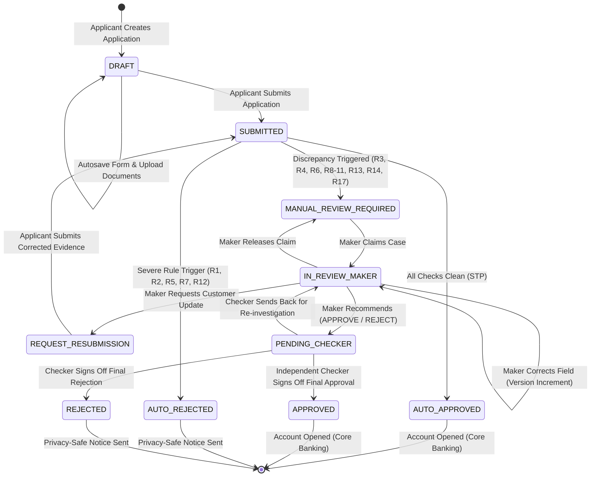
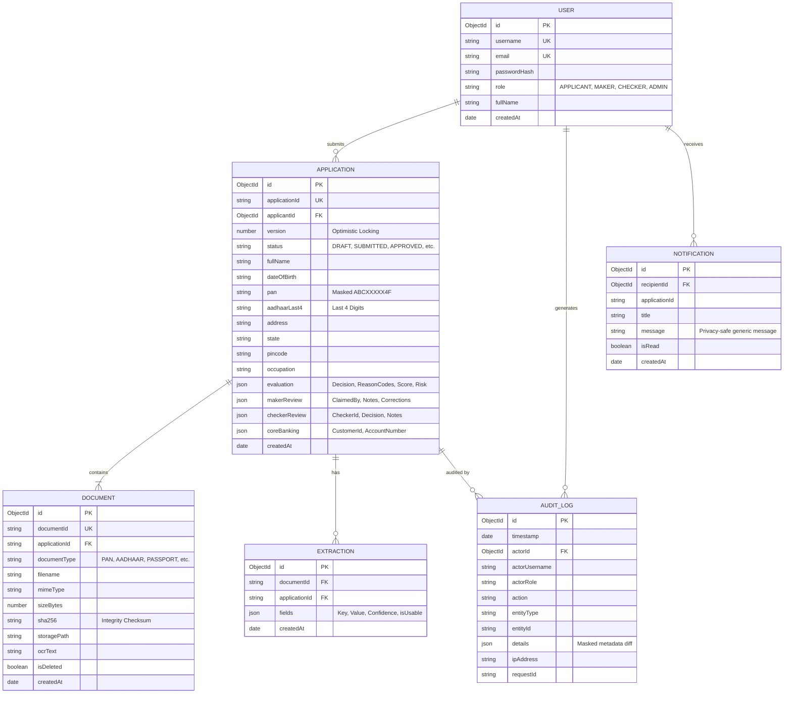
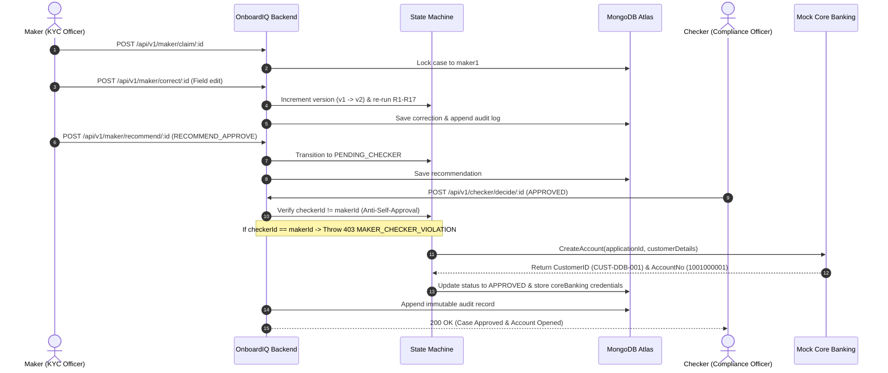

# OnboardIQ — System Design & Architecture Document
**System Name:** OnboardIQ — Intelligent KYC Onboarding & Dual-Control Screening Platform  
**Target Organization:** Deccan Digital Bank (Fictional Scheduled Commercial Bank)  
**Hackathon Track:** Full Stack Web Engineer  
**Date:** October 2026  
**Document Version:** 1.0.0

---

## 1. Executive Summary & System Overview

**OnboardIQ** is an enterprise-grade digital onboarding, document extraction, automated KYC validation, and watchlist screening platform designed for Deccan Digital Bank. The system automates routine identity verification while enforcing rigorous human-in-the-loop governance through a server-enforced **Maker-Checker** dual-control workflow.

### Key Highlights:
- **Deterministic Rules Engine:** Implements 17 documented business rules (R1 through R17) with strict decision precedence (`REJECT` > `REVIEW` > `APPROVE`). Zero reliance on non-deterministic LLMs for credit or KYC outcomes.
- **Dual-Control Governance:** Physical segregation of Maker (investigator/recommender) and Checker (approver/rejecter) roles. Complete server-side prohibition against self-approval.
- **Privacy-by-Design:** Aadhaar restricted to last 4 digits; PAN masked in all public APIs, audit logs, and reports (`ABCXXXXX4F`).
- **Pluggable Architecture:** Flexible extraction providers (Mock CSV and Rule-based AI) and synthetic Core Banking integration.

---

## 2. Business Rules & Decision Precedence Flowchart (R1–R17)

```mermaid
flowchart TD
    Start([Application Submitted]) --> Ext[Extract Fields & Usability Check]
    Ext --> R3{R3: Confidence >= 0.80?}
    R3 -- No --> FlagR3[Flag R3: LOW_EXTRACTION_CONFIDENCE\nSet Status: REVIEW]
    R3 -- Yes --> R1{R1: Age < 18?}
    FlagR3 --> R1

    R1 -- Yes --> FlagR1[Flag R1: AGE_BELOW_18\nSet Status: REJECT]
    R1 -- No --> R2{R2: Age > 120?}
    FlagR1 --> R2

    R2 -- Yes --> FlagR2[Flag R2: AGE_EXCEEDS_120\nSet Status: REJECT]
    R2 -- No --> R12{R12: Sanctions Exact Match?}
    FlagR2 --> R12

    R12 -- Yes --> FlagR12[Flag R12: SANCTIONS_EXACT_MATCH\nSet Status: REJECT]
    R12 -- No --> R7{R7: PAN Mismatch?}
    FlagR12 --> R7

    R7 -- Yes --> FlagR7[Flag R7: PAN_NUMBER_MISMATCH\nSet Status: REJECT]
    R7 -- No --> R5{R5: Name Similarity < 0.70?}
    FlagR7 --> R5

    R5 -- Yes --> FlagR5[Flag R5: NAME_MISMATCH_MAJOR\nSet Status: REJECT]
    R5 -- No --> R4{R4: Name Sim 0.70 - 0.85?}
    FlagR5 --> R4

    R4 -- Yes --> FlagR4[Flag R4: NAME_MISMATCH_MINOR\nSet Status: REVIEW]
    R4 -- No --> R6{R6: DOB Mismatch?}
    FlagR4 --> R6

    R6 -- Yes --> FlagR6[Flag R6: DOB_MISMATCH\nSet Status: REVIEW]
    R6 -- No --> R8{R8: Aadhaar Last 4 Mismatch?}
    FlagR6 --> R8

    R8 -- Yes --> FlagR8[Flag R8: AADHAAR_LAST4_MISMATCH\nSet Status: REVIEW]
    R8 -- No --> R9{R9: State Mismatch?}
    FlagR8 --> R9

    R9 -- Yes --> FlagR9[Flag R9: ADDRESS_STATE_MISMATCH\nSet Status: REVIEW]
    R9 -- No --> R10{R10: Pincode Invalid?}
    FlagR9 --> R10

    R10 -- Yes --> FlagR10[Flag R10: PINCODE_INVALID\nSet Status: REVIEW]
    R10 -- No --> R11{R11: Unemployed High Income?}
    FlagR10 --> R11

    R11 -- Yes --> FlagR11[Flag R11: OCCUPATION_UNEMPLOYED_HIGH_INCOME\nSet Status: REVIEW]
    R11 -- No --> R13{R13: Sanctions Fuzzy Match?}
    FlagR11 --> R13

    R13 -- Yes --> FlagR13[Flag R13: SANCTIONS_FUZZY_MATCH\nSet Status: REVIEW]
    R13 -- No --> R14{R14: PEP Match?}
    FlagR13 --> R14

    R14 -- Yes --> FlagR14[Flag R14: PEP_POLITICAL_RISK\nSet Status: REVIEW & High Risk]
    R14 -- No --> R17{R17: Existing Customer PAN?}
    FlagR14 --> R17

    R17 -- Yes --> FlagR17[Flag R17: EXISTING_CUSTOMER_DEDUPLICATION\nSet Status: REVIEW]
    R17 -- No --> Precedence[Evaluate Precedence R16:\nREJECT > REVIEW > APPROVE]
    FlagR17 --> Precedence

    Precedence --> Outcome{Overall Outcome}
    Outcome -- Any REJECT --> OutReject[Decision: REJECT\nStatus: AUTO_REJECTED]
    Outcome -- Any REVIEW --> OutReview[Decision: REVIEW\nStatus: MANUAL_REVIEW_REQUIRED\nEnqueue to Maker FIFO]
    Outcome -- No Trigger --> OutApprove[Decision: APPROVE\nStatus: APPROVED\nOpen Core Banking Account]
```

---

## 3. Workflow State Machine & Lifecycle Transitions

---

## 4. Entity Relationship (ER) Diagram

---

## 5. Maker-Checker Sequence & Core Banking Integration

---

## 6. Architecture & Non-Functional Specifications

1. **Deterministic Execution:** No AI or external LLM makes decisions. All outcomes are derived purely from rule triggers, Levenshtein distance calculations, and documented thresholds.
2. **Optimistic Locking:** Application records maintain an integer `version` field. Stale client updates are rejected with `409 Conflict`, requiring a client refresh.
3. **Double-Submit CSRF Protection:** Mutating endpoints require `X-CSRF-Token` header matching the issued token.
4. **Binary Signature Verification:** Uploaded files undergo magic byte inspection to reject executable or script payloads regardless of file extension.
5. **Append-Only Regulatory Audit:** Mongoose schema hooks strictly block any update or delete operation on the `audit_logs` collection.
